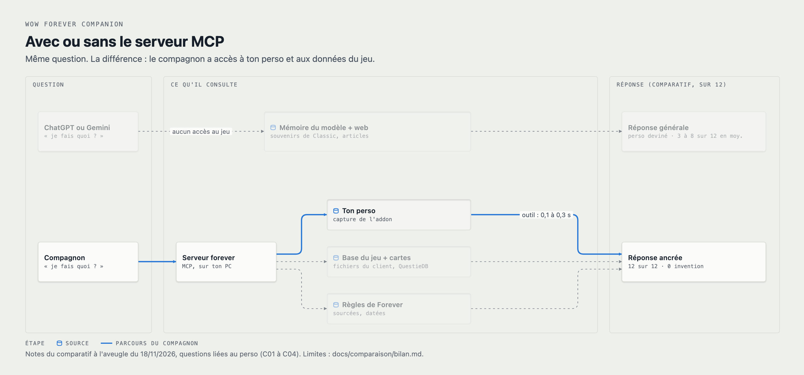
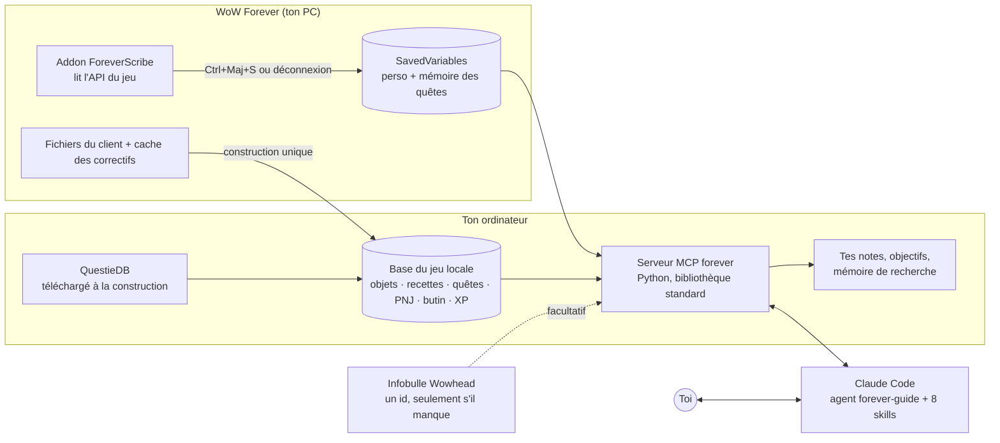
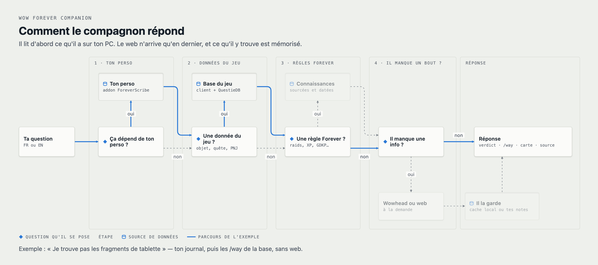
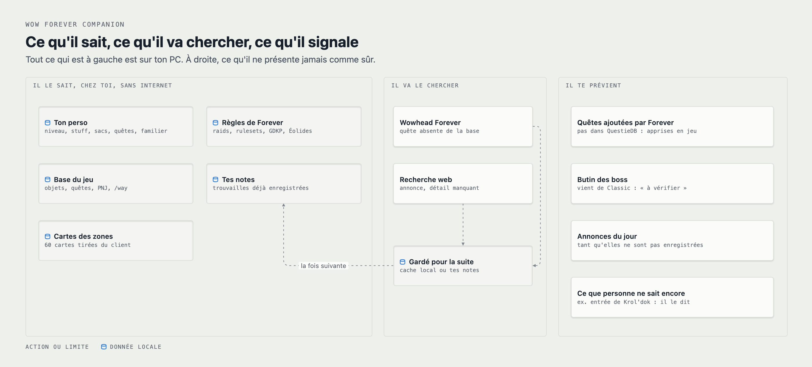
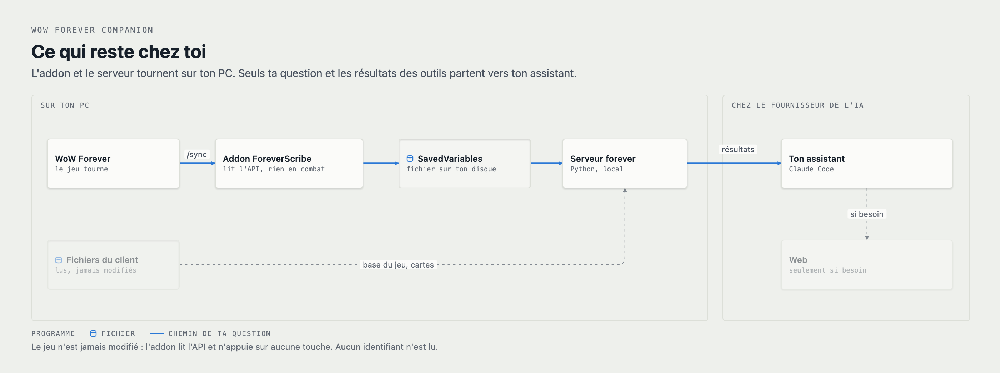

<div align="center">

# WoW Forever Companion

**Un guide taillé pour ton perso : des conseils personnalisés pour profiter au mieux de WoW Forever.**

Un compagnon IA pour *World of Warcraft: Forever*. Il connaît tes sacs, ton journal de
quêtes et les données du jeu, et tourne à côté du jeu dans
[Claude Code](https://claude.com/claude-code).

[](https://github.com/ArmanetPierre/wow-forever-companion/actions/workflows/tests.yml)
[](LICENSE)


[English version](README.md)

<!-- GIF à enregistrer : synchro en jeu → « Je fais quoi maintenant ? » → /way collé en jeu
     (docs/marketing/github.md, capture 1). -->

</div>

---

```
> Je fais quoi maintenant ?

Brannok · Nain Chasseur 25 · Les Paluns · synchro il y a 3 min

Rends d'abord tes 13 quêtes terminées, dont 4 ici même aux Paluns : c'est de l'XP
gratuite, et ton journal est plein de toute façon. Ensuite deux nouvelles près de
l'Excavation : La vengeance d'Ormer chez Ormer Ironbraid /way 38.2 50.9 et Découverte
du passé chez le Prospecteur Whelgar /way 38.8 52.4. Fais-les ensemble, elles se
recoupent.
                                                                  QuestieDB · sûr
```

## Pourquoi c'est différent

Demande à une IA généraliste quelque chose sur WoW Forever : elle te répond Classic, de
mémoire. Or Forever n'est pas Classic : nouvelle race, nouveaux donjons, objets revus,
quêtes inédites. Le compagnon répond à partir de ce qu'un chatbot n'a pas :

| | Un chatbot | Le compagnon |
|---|---|---|
| **Ton perso** | « Tu es quel niveau ? » | Lit ton niveau, ton stuff, tes talents, ton journal, ton familier, tes sacs et tes métiers, capturés en jeu |
| **Les données du jeu** | Les stats de Classic, de mémoire | Objets, stats, recettes, donjons et table d'XP lus dans *ton* client Forever et ses correctifs serveur |
| **Quêtes et PNJ** | « Quelque part aux Paluns » | Donneur, receveur, objectifs et apparitions en coordonnées `/way` ; les quêtes ajoutées par Forever apprises pendant que tu joues |
| **Honnêteté** | Tout sonne aussi sûr | Chaque info dit d'où elle vient (données Forever, QuestieDB, observé en jeu, souvenir Classic) et à quel point c'est sûr |
| **Le ton** | « Excellente question ! Il est important de noter… » | Parle comme ton pote de guilde : verdict d'abord, chiffres exacts, pas de blabla |

### Pourquoi pas juste ChatGPT ?

ChatGPT est bon sur l'actualité : GDKP interdits, nouveaux raids, Éolides. Sur ces questions,
il fait presque jeu égal. Mais il ne connaît pas **ton** perso, et quand il ne connaît pas
un détail de quête, il devine.

Test à l'aveugle du 18/11/2026, 12 questions, chaque réponse notée sur 12 :

| | Compagnon | ChatGPT | Gemini |
|---|---|---|---|
| Moyenne | **11,8** | 8,6 | 8,2 |
| Questions sur ton perso | **12** | 5 à 8 | 3 à 8 |
| Pièges Classic / inventions graves | **0 / 0** | 1 / 2 | 3 / 3 |

Pour les moyennes, ChatGPT et Gemini avaient une fiche du perso écrite à la main : c'est leur
meilleur cas. Les fourchettes couvrent les deux essais, avec et sans fiche ; les pièges et
inventions comptent l'essai sans fiche. Temps de réponse comparable (environ 10 à 25 s).
Limites : le juge est un modèle Claude, et les références partagent les sources du
compagnon. Rapport complet et transcriptions : [docs/comparaison/bilan.md](docs/comparaison/bilan.md).

<picture>
  <source media="(prefers-color-scheme: dark)" srcset="docs/marketing/schemas/3-avec-ou-sans-mcp-sombre.png">
  
</picture>

## Ce que tu peux lui demander

**« L'arbalète ou le fusil ? »**
```
Pas encore : il faut le niveau 26. Ensuite, c'est environ +2,4 DPS (+5,6 %) sur ton
fusil, mais ta compétence Arbalètes est à 1/125 : au début tu vas rater pas mal de
tirs. Monte-la sur des mobs gris ou verts avant de la sortir sur un élite.
                                                       Base locale Forever · probable
```

**« Découverte du passé, je trouve pas les fragments »**
```
Les 4 sont dans l'Excavation, à l'ouest du campement. Trois sont dans des Reliques
anciennes, le premier vers /way 34.1 49.9 ; le dernier est dans une Terre meuble vers
/way 33.1 46.4. Les troggs respawn vite là-dedans : pull un par un. Retour chez
Whelgar /way 38.8 52.4.
                                                                  QuestieDB · sûr
```

**« Évalue mon stuff »**
```
Ton point faible, c'est les jambes : les Jambières pétrolifères (rares, niveau 25)
te font environ +2 DPS, butin courant sur 13 PNJ. Tête, cou et bijoux vides, c'est
normal à 25 : ne cours pas après. Et le bouquet qui traîne dans tes sacs fait mieux
que celui de ta main gauche (+4 End) : équipe-le.
                                                            Base locale Forever · sûr
```

**« Il me faut combien pour le 40 ? »**
```
823 312 XP du niveau 25 au 40 : 6 912 pour finir le 25, puis 816 400 du 26 au 39.
Tu as aussi 912 d'XP reposée en réserve, qui double l'XP des monstres jusqu'à
épuisement.
                                                            Base locale Forever · sûr
```

**Et aussi :** « Mon familier est malheureux », « Comment passer de 106 à 150 en Travail du
cuir ? », « Quelles quêtes je peux rendre ici ? », « Où est le Montagnard Rockgar ? »,
« Quels raids ouvrent le 9 décembre ? », « Je joue mon prêtre ».

Pose ta question en français ou en anglais ; les noms du jeu restent ceux de ton client.

## Comment ça marche



1. **L'addon** capture ton perso en jeu : identité, XP, position, stats, équipement,
   talents, sorts, quêtes et leurs récompenses, métiers et recettes, familier, sacs,
   banque, or, réputations. Pendant que tu joues, il retient aussi qui donne et qui reçoit
   chaque quête, et où (commun à tous les persos du compte). Il lit l'API, il n'agit
   jamais : aucune touche automatisée, rien en combat.
2. **Le serveur MCP** en fait 15 outils que l'agent appelle : `overview`, `gear`, `quests`,
   `npc`, `item`, `professions`, `pet`, `talents`, `dungeon`, `bags`, `reputations`,
   `search`, `save_knowledge`, `characters`, et `map`, qui dessine la carte de la zone tirée
   de ton client, avec un repère numéroté pour chaque `/way`. La plupart des questions se règlent en
   **un seul appel**.
3. **La base locale** est construite à partir de ton propre client Forever et de son cache
   de correctifs, plus les données communautaires de QuestieDB téléchargées chez toi :
   environ 24 700 objets, 4 244 quêtes, 10 119 PNJ, 80 313 positions pour `/way`, les
   sources de butin et la table d'XP.
4. **L'agent** croise tout et répond comme un vétéran de ta guilde : verdict d'abord,
   chiffres exacts, source et certitude. Il garde ce qu'il a dû chercher, pour répondre
   tout de suite la fois suivante. Envie de plus d'ambiance ? `"voix": "pnj"` le fait
   parler comme un PNJ de ta race ; `"neutre"` le garde sobre.

<picture>
  <source media="(prefers-color-scheme: dark)" srcset="docs/marketing/schemas/1-comment-il-repond-sombre.png">
  
</picture>

<picture>
  <source media="(prefers-color-scheme: dark)" srcset="docs/marketing/schemas/2-ce-quil-sait-sombre.png">
  
</picture>

| Sous le capot | |
|---|---|
| Outils | 15, chacun avec un `lang` facultatif (`fr` / `en`) |
| Appels d'outils par question | 1,0 en moyenne ([banc d'essai](docs/evals/)) |
| Coût fixe en contexte | ≈ 4,6 k tokens (schémas des outils, règles du serveur, descriptions des skills) |
| Questions de vrais joueurs pour les tests | 72, rejouées après chaque changement |

## Installation en 3 étapes

**1. Télécharge l'installateur de ton système, décompresse-le, double-clique dessus.**

| macOS | Windows |
|---|---|
| [**WoW-Forever-Companion-macOS.zip**](https://github.com/ArmanetPierre/wow-forever-companion/releases/latest/download/WoW-Forever-Companion-macOS.zip) → *Installer WoW Forever Companion.command* | [**WoW-Forever-Companion-Windows.zip**](https://github.com/ArmanetPierre/wow-forever-companion/releases/latest/download/WoW-Forever-Companion-Windows.zip) → *Installer WoW Forever Companion.cmd* |

Il trouve ton jeu, installe l'addon ForeverScribe, ajoute le plugin à Claude Code, crée ton
dossier de joueur (`~/WowForever`) et propose de construire la base locale du jeu. Il dit ce
qu'il fait à chaque étape, ne touche jamais à tes données de joueur et n'installe rien
d'autre (Python, Claude Code) sans un « oui » tapé. Relance-le pour **mettre à jour** ;
`--uninstall` (Windows : `-Uninstall`) retire l'addon et le plugin.

Tu préfères le terminal ? Le même installateur, en une ligne :

```bash
# macOS / Linux
curl -fsSL https://raw.githubusercontent.com/ArmanetPierre/wow-forever-companion/main/install/install.sh | bash
```

```powershell
# Windows (PowerShell)
irm https://raw.githubusercontent.com/ArmanetPierre/wow-forever-companion/main/install/install.ps1 | iex
```

**2. Redémarre complètement le jeu**, puis **Ctrl+Maj+S** (ou `/sync`) pour synchroniser.

**3. Pose ta question :** `cd ~/WowForever && claude`, puis « Je fais quoi maintenant ? »

**Ce qu'il te faut avant.** [Python 3.9+](https://www.python.org/downloads/) et
[Claude Code](https://claude.com/product/claude-code) (abonnement Claude). L'installateur
vérifie les deux. Il **n'installe pas** Python : s'il manque, il t'envoie sur python.org et
attend. Il propose de lancer l'installateur officiel de Claude Code d'Anthropic, seulement
après ta confirmation.

**macOS, premier lancement.** L'installateur n'est pas encore signé : la première fois, macOS
bloque le fichier. Ouvre **Réglages système › Confidentialité et sécurité**, puis clique sur
**Ouvrir quand même**. Ou, dans le Terminal :
`xattr -dr com.apple.quarantine ~/Downloads/"WoW Forever Companion"` (le dossier décompressé).
La commande en une ligne ci-dessus évite complètement le problème.
**Windows :** si SmartScreen s'affiche, **Informations complémentaires** > **Exécuter quand même**.
Installation manuelle et options : [Installation complète](#installation-complète).

## FAQ

**Blizzard l'autorise ?**
L'addon utilise l'API standard des addons, comme n'importe quel addon de sacs ou de
quêtes. Il lit, il n'agit jamais : pas de touches simulées, pas d'automatisation, rien en
combat, pas de lecture d'écran ni de mémoire. La synchro demande un geste de ta part,
parce que le jeu l'exige. Les questions se posent hors du jeu.

**Où vont mes données ?**
La capture est un fichier que le jeu écrit sur ton disque ; le serveur le lit en local.
Elle n'arrive dans ta propre session Claude que quand tu poses une question. Aucun
identifiant de connexion n'est lu, et ton numéro de compte est masqué dans les réponses
des outils. Les données de tes amis restent chez eux.

**Il va sur Internet ?**
La construction de la base télécharge une fois CascLib, les définitions des tables et
QuestieDB. Quand aucune source locale ne connaît une quête ou un PNJ, le serveur peut
demander l'infobulle publique de Wowhead pour cet id (3 requêtes au plus par question,
mises en cache, rien sur toi dans l'adresse). Pour couper : `"web_lookup": false` dans
`perso/config.json`.

**Je peux le partager avec mes amis ?**
Oui, c'est fait pour. Chacun l'installe et garde ses données. Plusieurs comptes et
plusieurs persos par ordinateur sont gérés.

**Pourquoi la base du jeu n'est pas dans le dépôt ?**
Ce sont les données de Blizzard. Le script la construit chez toi, depuis ton client.
Les données de QuestieDB (sans licence déclarée, Questie est sous GPLv3) sont
téléchargées à la construction, jamais redistribuées ici.

**Il sait tout sur Forever ?**
Non, et il le dit. Les quêtes ajoutées par Forever manquent dans QuestieDB : le compagnon se
rabat sur la mémoire des quêtes de l'addon, le texte des quêtes du client et Wowhead, et
marque ce qui est deviné comme « probable ». Les sources de butin viennent de QuestieDB,
qui s'appuie sur Classic. Quand l'agent s'appuie sur Classic, il te dit de vérifier en jeu.

**Ça coûte combien ?**
Le projet est gratuit (MIT). Les réponses utilisent ton abonnement Claude Code ou ton
usage de l'API.

## Installation complète

### Ce que contient le projet

| Élément | Rôle |
|---|---|
| Addon **ForeverScribe** | capture en jeu l'état de ton perso : identité, XP, position, stats, équipement, talents, sorts, quêtes, métiers et recettes, familier, sacs, banque, or, réputations, plus la mémoire des quêtes commune au compte |
| Plugin Claude Code **forever-companion** | l'agent `forever-guide`, 8 skills, une base de connaissances Forever et le serveur MCP |
| Serveur MCP **forever** | lit les captures de l'addon et les donne à l'agent (15 outils) ; tient ton profil et ton journal à jour tout seul ; garde la mémoire de recherche |
| **Base locale du jeu** (facultative) | objets, stats, armure, DPS, recettes, donjons, quêtes, PNJ, sources de butin et table d'XP, tirés de *ton* client Forever et de QuestieDB, pour répondre sans chercher sur le web |

Skills : `forever-quetes`, `forever-leveling`, `forever-metiers`, `forever-talents`,
`forever-donjons`, `forever-equipement`, `forever-familier`, `forever-profil`.

### Prérequis

- World of Warcraft: Forever (client français ou anglais)
- [Claude Code](https://claude.com/claude-code)
- Python 3.9 ou plus (déjà présent sur macOS et Linux ; à installer sur Windows, voir
  [Windows et Linux](#windows-et-linux))

### Installation

**1. L'addon**

```bash
git clone https://github.com/ArmanetPierre/wow-forever-companion.git
cd wow-forever-companion
addon/install.sh                 # macOS / Linux (détecte le dossier du jeu)
```

Windows (PowerShell) : `powershell -ExecutionPolicy Bypass -File addon\install.ps1`.
Dossier du jeu non trouvé : ajoute `--wow-path "/chemin/vers/World of Warcraft/_forever_"`
(`-WowPath` sous Windows). Sans script : copie `addon/ForeverScribe` dans
`World of Warcraft/_forever_/Interface/AddOns/`.

Puis **quitte complètement le jeu et relance-le**, coche ForeverScribe dans la liste des
AddOns (et « Charger les addons obsolètes » si besoin). Refais-le après chaque mise à jour
de l'addon qui ajoute un fichier.

**2. Le plugin**, dans Claude Code :

```
/plugin marketplace add ArmanetPierre/wow-forever-companion
/plugin install forever-companion@wow-forever-companion
```

**3. Ton dossier de joueur** : c'est là que vivent tes données, en dehors du projet.

```bash
mkdir -p ~/WowForever && cd ~/WowForever && claude
```

Lance toujours Claude Code depuis ce dossier pour parler à ton compagnon. Copie-y le modèle
[`perso.example/CLAUDE.md`](perso.example/CLAUDE.md) (renomme-le `CLAUDE.md` et remplis
ton prénom et ton perso ; modèle anglais :
[`perso.example/CLAUDE.example.en.md`](perso.example/CLAUDE.example.en.md)) : il dit à
Claude de charger tous les outils `forever` en un seul appel en début de session
(`ToolSearch` avec la requête `+forever`), de consulter la mémoire de recherche avant le web
et de suivre la charte de réponse.

### Utilisation

1. En jeu, synchronise : **Ctrl+Maj+S**, `/sync` ou le bouton parchemin près de la
   minicarte (court écran de chargement ; refusé en combat). La déconnexion synchronise
   aussi toute seule. Si le raccourci ne répond pas : `/scribe touche`.
2. Dans Claude Code, pose ta question :
   - « Je fais quoi maintenant ? »
   - « Quelles quêtes je peux rendre ici ? »
   - « Je prends cette arbalète : 24-37, 15,2 DPS, +12 PA à distance ? »
   - « Mon familier est malheureux, je fais quoi ? »
   - « Comment monter mon Travail du cuir de 106 à 150 ? »
   - « Évalue mon stuff » (récompenses de quête comprises)
   - « Il me faut combien d'XP pour le 40 ? »

Chaque réponse commence par un verdict en une ligne, puis quelques lignes de détail, la
provenance ([Forever], [Classic], [Retail]) et la certitude. Si ta question dépend de ton
état actuel et que les données ont plus d'une heure, l'agent te propose de synchroniser.

Outils (un appel suffit à la plupart des questions) : `overview` (quoi faire : résumé
calculé à chaque synchro ; `niveau_cible` donne l'XP jusqu'à un niveau), `gear`
(améliorations classées depuis les récompenses de quête, les sacs et la base du jeu ;
comparaison d'objet), `quests` (journal, une quête, quêtes à prendre), `npc`, `item`,
`professions`, `pet`, `talents`, `dungeon`, `bags`, `reputations`, `search` (n'importe quel
nom, en français ou en anglais, avant le web), `save_knowledge`, `characters`. Chaque outil
accepte un `lang` facultatif (`fr` / `en`). Les noms de la v0.7 (`get_overview`,
`find_upgrades`…) marchent toujours.

**Voix.** `"voix"` dans `perso/config.json` : `joueur` (défaut, ton de vétéran de guilde),
`pnj` (plus immersif) ou `neutre`. Voir
[`knowledge/voix.md`](plugins/forever-companion/knowledge/voix.md).

**Mémoire des quêtes.** Depuis l'addon 1.4, l'addon note pendant que tu joues qui donne et
qui reçoit chaque quête, avec sa position, les quêtes qu'un PNJ propose et où tes objectifs
avancent. Elle est commune à tous les persos du compte, de taille bornée et en pause en
combat. À la synchro, elle devient `perso/<Prénom>/memoire-quetes.json`, la source la plus
fiable pour les quêtes ajoutées par Forever (`[Forever · observé en jeu]`).

**Mémoire de recherche.** Quand l'agent a dû chercher longtemps (« y a-t-il des casques à
mon niveau ? »), il enregistre la réponse avec `save_knowledge` dans
`~/WowForever/connaissances/` : un fichier Markdown par sujet, daté, avec ses sources et sa
certitude. À la question suivante, `search` répond en un appel. Ce sont de
simples fichiers texte : relis-les, corrige-les ou supprime-les librement.

**Recherches Wowhead.** Seulement quand aucune source locale ne place un PNJ ou ne nomme une
quête : une requête d'infobulle publique par id manquant, 3 au plus par appel d'outil, mises
en cache dans `~/WowForever/gamedata/.cache/wowhead/`. Pour couper : `"web_lookup": false`
dans `perso/config.json` ou `FOREVER_WEB_LOOKUP=0`.

Autres commandes en jeu : `/scribe` (capture + résumé), `/scribe status` (état de chaque
domaine, taille de la mémoire des quêtes), `/scribe bouton` (afficher/masquer le bouton),
`/scribe help`.

### Langue

- **Langue des réponses** : celle de ta question. Pour l'imposer partout (y compris
  `profil.md` et `journal.md` générés par la synchro), ajoute `"answer_language": "fr"` ou
  `"en"` dans `perso/config.json`. Sans réglage, les fichiers générés suivent la langue du
  client du perso.
- **Langue du jeu** : celle de ton client (frFR, enUS…). Les noms d'objets, quêtes, zones
  et PNJ restent ceux que tu vois en jeu, même si tu poses ta question dans l'autre langue.
  Avec `lang: en`, les fiches de quêtes et de PNJ prennent les noms anglais de QuestieDB et
  rappellent le titre affiché dans ton jeu.
- La base de connaissances du plugin (`knowledge/`) est en français ; l'agent la traduit à
  la volée.

### Tes données

<picture>
  <source media="(prefers-color-scheme: dark)" srcset="docs/marketing/schemas/4-ce-qui-reste-chez-toi-sombre.png">
  
</picture>

- **Tout reste sur ton ordinateur.** L'addon écrit un fichier du jeu ; le serveur MCP le
  lit localement. Les informations ne sortent que vers ta propre session Claude, quand tu
  poses une question.
- Aucun identifiant de connexion n'est lu ni stocké ; le numéro de compte est masqué dans
  les réponses des outils.
- Emplacement du dossier de données, dans cet ordre : variable `FOREVER_DATA_DIR`, sinon
  `perso/` dans le dossier où tu lances Claude Code, sinon `~/WowForever/perso`. Un nouveau
  dossier `perso/` est créé privé (`0700`) sous macOS et Linux.

```
~/WowForever/
├── CLAUDE.md                    consignes du compagnon (modèle : perso.example/CLAUDE.md)
├── connaissances/               mémoire de recherche (FOREVER_KNOWLEDGE_DIR pour la déplacer)
├── gamedata/                    base du jeu locale + cache des téléchargements
└── perso/
    ├── config.json              dossier du jeu, comptes, perso actif, answer_language, voix, web_lookup
    └── <Prénom>/
        ├── memoire-quetes.json  mémoire des quêtes fusionnée depuis l'addon
        └── <Perso>-<Région>/
            ├── profil.md        section auto + tes notes
            ├── objectifs.md     tes objectifs (à toi de l'écrire)
            ├── journal.md       tes notes + journal automatique
            ├── etat.json        dernière capture
            ├── resume.json      résumé calculé à la synchro (utilisé par overview)
            └── historique/      un instantané par jour
```

### Plusieurs persos, plusieurs joueurs

- Tous tes persos sont suivis : l'agent répond pour le dernier joué, ou dis « je joue mon
  mage ». Connecte chaque perso une fois avec l'addon actif.
- Plusieurs comptes WoW sur le même ordinateur : chaque compte est rattaché à un prénom
  (l'agent te le demande).
- Tes amis installent le projet chez eux : leurs données restent chez eux.

### Construire la base du jeu

Facultatif mais recommandé : l'agent trouve alors seul les améliorations d'équipement
(`gear`), les fiches d'objets et où ils tombent, les recettes d'un métier, les boss et le
butin des donjons, les quêtes et les PNJ, sans recherche web. La base est construite
**chez toi, à partir de ton client** ; rien n'est téléchargé depuis un site de jeu et le
dossier du jeu n'est jamais modifié.

```bash
python3 tools/gamedata/build_db.py
```

- Options : `--wow "<dossier World of Warcraft>"` si le jeu n'est pas trouvé,
  `--data-dir <dossier>` (défaut `~/WowForever`), `--locale frFR`, `--force`.
- Lance le jeu au moins une fois avant : les correctifs de Forever (objets nouveaux ou
  refaits) sont dans son cache `DBCache.bin`. Relance la commande après une mise à jour du
  jeu ; elle ne refait rien si rien n'a changé.
- La première fois, elle télécharge depuis GitHub et compile
  [CascLib](https://github.com/ladislav-zezula/CascLib) (lecture du stockage du jeu, MIT) et
  les définitions [WoWDBDefs](https://github.com/wowdev/WoWDBDefs) (structure des tables).
  Il faut `git`, `cmake` et un compilateur C (macOS : `xcode-select --install` puis
  `brew install cmake` ; Linux : `apt install git cmake build-essential`). Sous Windows,
  CascLib se compile tout seul si `git` et `cmake` sont installés avec Visual Studio Build
  Tools ; sinon la commande affiche les étapes.
- Langue : celle de ton client, détectée seule (`Config.wtf`, sinon `.build.info`) ;
  `--locale enUS` en force une autre installée.
- **Quêtes et PNJ** (donneur, receveur, objectifs et où, `/way`, chaîne, quêtes à prendre
  dans une zone, où est un PNJ, ce qu'il lâche) : la commande télécharge ensuite les données
  Forever de [QuestieDB](https://github.com/Questie/QuestieDB) (base communautaire de
  l'addon Questie), à une révision fixée, et les fusionne dans ta base (outils `quests`,
  `npc`, `item`, `dungeon`). Ces fichiers ne font **pas** partie de ce dépôt (licence non
  déclarée, Questie est sous GPLv3) et sont seulement lus comme des données. `--no-questie`
  pour s'en passer ; pour les ajouter à une base existante :
  `cd plugins/forever-companion && python3 -m gamedata.questie`.
- **Caches du client** : les caches de quêtes, de créatures et d'objets du monde de ton
  client (`Cache/WDB`) sont ajoutés à la construction et rafraîchis à chaque synchro
  (`python3 -m gamedata.clientcache` le lance seul).
- Résultat : `~/WowForever/gamedata/forever-<langue>.sqlite`, par ex. `forever-frFR.sqlite`
  (≈ 17 Mo avec QuestieDB, quelques secondes) ; dépendances dans
  `~/WowForever/gamedata/.cache/`. Schéma : [docs/schema-gamedb.md](docs/schema-gamedb.md).
- Limites : les sources de butin viennent de QuestieDB (basé sur Classic, et indiqué comme
  tel) ; les quêtes ajoutées par Forever n'y sont pas ; le rang requis des recettes est
  estimé.

### Windows et Linux

- **Windows** : le plugin lance son serveur avec `python3` par défaut. Avec l'installeur de
  python.org, Windows fournit plutôt `py` et `python` (le `python3` de l'alias du Microsoft
  Store ne fait souvent rien). Indique au plugin lequel utiliser, puis relance Claude Code :
  `setx FOREVER_PYTHON py` (ou `setx FOREVER_PYTHON python`). Le dossier du jeu est trouvé
  via le registre, les réglages Battle.net et les lecteurs habituels.
- **Linux** : le jeu tourne via Wine, Lutris, Proton ou Bottles ; l'addon fonctionne
  normalement. Les préfixes Wine, les jeux Lutris (`prefix:`), les `compatdata` de Steam et
  Bottles sont parcourus. Si le dossier du jeu n'est toujours pas trouvé :
  `python3 plugins/forever-companion/mcp/sync.py --wow "/chemin/vers/World of Warcraft"`.
- Les tests tournent sous macOS, Windows et Ubuntu à chaque push
  ([CI](.github/workflows/tests.yml)) ; points de portabilité connus :
  [docs/portabilite.md](docs/portabilite.md).

### Dépannage

| Problème | Solution |
|---|---|
| L'addon n'apparaît pas | quitte et relance le jeu (un `/reload` ne charge pas un nouvel addon) ; sinon réinstalle avec `--copy` |
| « Aucun perso connu » | connecte ton perso, synchronise (Ctrl+Maj+S), vérifie que tu lances Claude Code depuis `~/WowForever` |
| Ctrl+Maj+S ne fait rien | `/scribe touche`, ou Options → Raccourcis → AddOns → ForeverScribe |
| Recettes ou banque vides | ouvre une fois la fenêtre du métier ou la banque, puis synchronise |
| Dossier du jeu introuvable | `sync.py --wow "<dossier du jeu>"` (il est ensuite retenu) |
| « Récompenses de quête inconnues » | mets l'addon à jour (1.2 ou plus), relance le jeu une fois, puis synchronise |
| Le serveur `forever` ne démarre pas (Windows) | `setx FOREVER_PYTHON py` (ou `python`), puis relance Claude Code |
| Une quête ajoutée par Forever n'a pas de donneur | joue avec l'addon 1.4 ou plus : la mémoire des quêtes le note quand tu croises le PNJ |

## Feuille de route

- Questions posées directement en jeu (expérimental)
- Cache local des sources de référence
- Analyse de combat (compteur de dégâts intégré à Forever)

Banc d'évaluation du compagnon (72 questions de vrais joueurs, scénarios rejouables,
critères, budgets) : [docs/evals/](docs/evals/). Détails de conception :
[docs/conception/](docs/conception/), format des données : [docs/schema.md](docs/schema.md),
API vérifiée : [docs/api-inventaire.md](docs/api-inventaire.md).

## Contribuer

Les retours de joueurs sous Windows et Linux, les tests avec un client anglais et les
données sur les quêtes ajoutées par Forever sont les contributions les plus utiles en ce
moment. Voir [CONTRIBUTING.md](CONTRIBUTING.md).

## Licence

[MIT](LICENSE) © 2026 Pierre Armanet.
Projet de fan, ni affilié à Blizzard Entertainment ni approuvé par lui. World of Warcraft
et Blizzard Entertainment sont des marques ou des marques déposées de Blizzard
Entertainment, Inc. Les données de quêtes et de PNJ viennent de la communauté
[Questie](https://github.com/Questie/QuestieDB) et ne font pas partie de ce dépôt.
