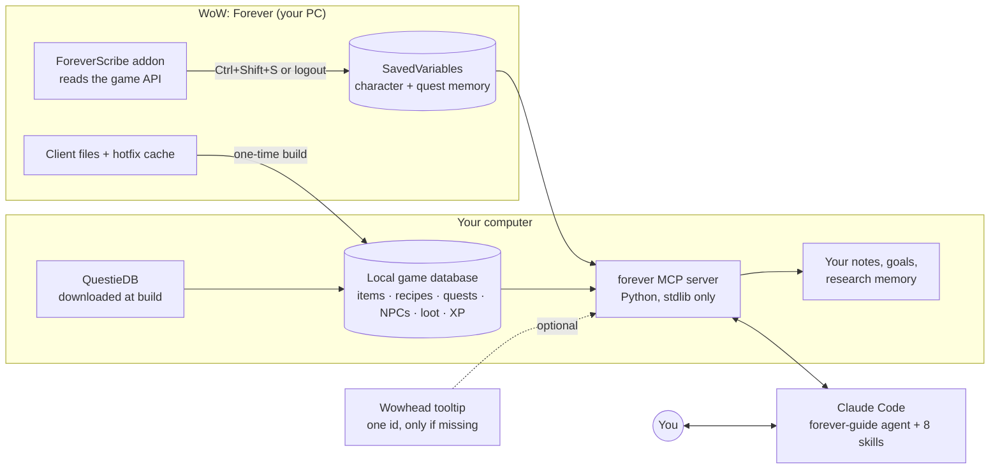

<div align="center">

# WoW Forever Companion

**Forever isn't Classic. Your companion knows the difference.**

An AI companion for *World of Warcraft: Forever*. It knows your bags, your quest log and the
game's own data, and it runs next to the game in [Claude Code](https://claude.com/claude-code).

[](https://github.com/ArmanetPierre/wow-forever-companion/actions/workflows/tests.yml)
[](LICENSE)


[Version française](README.fr.md)

<!-- GIF to record: sync in game → "What should I do now?" → /way pasted in game
     (docs/marketing/github.md, capture 1). -->

</div>

---

```
> What should I do now?

Brannok · Dwarf Hunter 25 · Wetlands · synced 3 min ago

Turn in your 13 finished quests first, 4 of them right here in the Wetlands: free XP,
and your log is full anyway. Then two new ones by the dig site: Ormer's Revenge from
Ormer Ironbraid /way 38.2 50.9 and Uncovering the Past from Prospector Whelgar
/way 38.8 52.4. Do them together, they overlap.
                                                            QuestieDB · confirmed
```

## Why it's different

Ask a general AI about WoW: Forever and you get Classic, from memory. Forever is not Classic:
it has a new race, new dungeons, reworked items and its own quests. The companion answers
from things a chatbot doesn't have:

| | A chatbot | The companion |
|---|---|---|
| **Your character** | "What level are you?" | Reads your level, gear, talents, quest log, pet, bags and professions, captured in game |
| **The game's data** | Classic stats from memory | Items, stats, recipes, dungeons and the XP table read from *your* Forever client and its server hotfixes |
| **Quests and NPCs** | "Somewhere in the Wetlands" | Giver, turn-in, objectives and spawns as `/way` coordinates; quests added by Forever learned as you play |
| **Honesty** | Every claim sounds equally sure | Every fact says where it comes from (Forever data, QuestieDB, seen in game, Classic memory) and how sure it is |
| **Tone** | "Great question! It's important to note…" | Talks like your guildmate: verdict first, exact numbers, no filler |

## What you can ask

**"Crossbow or rifle?"**
```
Not yet: it needs level 26. After that it's about +2.4 DPS (+5.6%) over your
rifle, but your Crossbows skill is 1/125, so you'll miss a lot of shots at first.
Level the skill on grey or green mobs before you bring it to an elite.
                                                     Forever local DB · likely
```

**"Uncovering the Past, I can't find the fragments."**
```
All 4 are in the dig site west of camp. Three sit in Ancient Relics, the first
around /way 34.1 49.9; the last one is in Loose Soil around /way 33.1 46.4.
Troggs respawn fast in there: pull them one at a time. Turn in to Whelgar
/way 38.8 52.4.
                                                            QuestieDB · confirmed
```

**"Rate my gear."**
```
Your weak spot is your legs: Petrolspill Leggings (rare, level 25) are about
+2 DPS for you, a common drop from 13 NPCs. Empty head, neck and trinkets are
normal at 25, don't chase them. And the flower bouquet sitting in your bags beats
the one in your off-hand (+4 Sta): equip it.
                                                     Forever local DB · confirmed
```

**"How long until 40?"**
```
823,312 XP from level 25 to 40: 6,912 to finish level 25, then 816,400 for 26 to
39. You also have 912 rested XP in reserve, which doubles mob XP until it runs out.
                                                     Forever local DB · confirmed
```

**More:** "My pet is unhappy", "How do I go from 106 to 150 Leatherworking?", "Which quests
can I turn in here?", "Where is Mountaineer Rockgar?", "Which raids open on December 9?",
"I'm playing my priest now".

Ask in English or French. Item and quest names stay as your client shows them.

## How it works



1. **The addon** captures your character in game: identity, XP, position, stats, gear,
   talents, spells, quests and their rewards, professions and recipes, pet, bags, bank,
   gold, reputations. While you play, it also remembers who gives and takes each quest and
   where (shared by all characters of the account). It only reads the game API: no key
   automation, nothing in combat.
2. **The MCP server** turns that into 15 tools the agent calls: `overview`, `gear`, `quests`,
   `npc`, `item`, `professions`, `pet`, `talents`, `dungeon`, `bags`, `reputations`,
   `search`, `save_knowledge`, `characters`, and `map`, which draws the zone map from your
   client with numbered markers for each `/way`. Most questions are answered in **one call**.
3. **The local database** is built from your own Forever client and hotfix cache, plus the
   community QuestieDB data downloaded on your machine: about 24,700 items, 4,244 quests,
   10,119 NPCs, 80,313 positions for `/way`, loot sources and the XP table.
4. **The agent** crosses all of it and answers like a veteran guildmate: verdict first,
   exact numbers, source and certainty. It saves what it had to look up, so the next answer
   is instant. Want more flavour? `"voix": "pnj"` makes it talk like an NPC of your race;
   `"neutre"` keeps it plain.

| Under the hood | |
|---|---|
| Tools | 14, each one taking an optional `lang` (`en` / `fr`) |
| Tool calls per question | 1.0 on average ([evaluation bench](docs/evals/)) |
| Fixed context cost | ≈ 4.6k tokens (tool schemas, server rules, skill descriptions) |
| Test questions from real players | 72, replayed after each change |

## Install in 3 steps

```bash
# 1. The addon (then fully restart the game)
git clone https://github.com/ArmanetPierre/wow-forever-companion.git
cd wow-forever-companion && addon/install.sh        # Windows: addon\install.ps1
```

```
# 2. The plugin, inside Claude Code
/plugin marketplace add ArmanetPierre/wow-forever-companion
/plugin install forever-companion@wow-forever-companion
```

```bash
# 3. Your player folder, then ask away
mkdir -p ~/WowForever && cd ~/WowForever && claude
```

In game, press **Ctrl+Shift+S** (or `/sync`) to sync. Optional but recommended:
`python3 tools/gamedata/build_db.py` builds the local game database. On Windows, tell the
plugin which Python to use first: `setx FOREVER_PYTHON py`. Details in [Full setup](#full-setup).

## FAQ

**Is this allowed by Blizzard?**
The addon uses the standard addon API, like any bag or quest addon. It reads, it never acts:
no key presses, no automation, nothing in combat, no screen or memory reading. Syncing
needs a key press from you, because the game requires one. Your questions are asked
outside the game.

**Where does my data go?**
The capture is a file the game writes on your disk; the server reads it locally. It reaches
your own Claude session only when you ask a question. No login credentials are read, and
your account number is masked in the tools' output. Your friends' data stays on their
machines.

**Does it go online?**
Building the database downloads CascLib, the table definitions and QuestieDB once. When no
local source knows a quest or an NPC, the server can ask Wowhead's public tooltip for that
one id (at most 3 requests per question, cached, nothing about you in the URL). Turn it off
with `"web_lookup": false` in `perso/config.json`.

**Can I share it with friends?**
Yes, that's the point. Each player installs it and keeps their own data. Several accounts
and characters per computer are supported.

**Why isn't the game database in the repo?**
It's Blizzard's data. The script builds it on *your* machine from *your* client. QuestieDB
data (no declared licence, Questie is GPLv3) is downloaded at build time, never
redistributed here.

**Does it know everything about Forever?**
No, and it says so. Quests added by Forever are missing from QuestieDB: the companion falls
back on the addon's quest memory, the client's quest text and Wowhead, and marks guesses as
« probable ». Loot sources come from QuestieDB, which is based on Classic. When the agent
relies on Classic knowledge, it tells you to check in game.

**What does it cost?**
The project is free (MIT). Answers use your Claude Code subscription or API usage.

## Full setup

### What's in the project

| Part | Role |
|---|---|
| **ForeverScribe** addon | captures your character's state in game: identity, XP, position, stats, gear, talents, spells, quests, professions and recipes, pet, bags, bank, gold, reputations, plus the account-wide quest memory |
| **forever-companion** Claude Code plugin | the `forever-guide` agent, 8 skills, a Forever knowledge base and the MCP server |
| **forever** MCP server | reads the addon captures and serves them to the agent (15 tools); keeps your profile and journal up to date; keeps the research memory |
| **Local game database** (optional) | items, stats, armor, DPS, recipes, dungeons, quests, NPCs, loot sources and the XP table, read from *your* Forever client plus QuestieDB, to answer without searching the web |

Skills: `forever-quetes` (quests), `forever-leveling`, `forever-metiers` (professions),
`forever-talents`, `forever-donjons` (dungeons), `forever-equipement` (gear),
`forever-familier` (hunter pet), `forever-profil` (characters and notes).

### Requirements

- World of Warcraft: Forever (English or French client)
- [Claude Code](https://claude.com/claude-code)
- Python 3.9 or later (already on macOS and Linux; install it on Windows, see
  [Windows and Linux](#windows-and-linux))

### Installation

**1. The addon**

```bash
git clone https://github.com/ArmanetPierre/wow-forever-companion.git
cd wow-forever-companion
addon/install.sh                 # macOS / Linux (finds the game folder)
```

Windows (PowerShell): `powershell -ExecutionPolicy Bypass -File addon\install.ps1`.
Game folder not found: add `--wow-path "/path/to/World of Warcraft/_forever_"`
(`-WowPath` on Windows). Without the script: copy `addon/ForeverScribe` into
`World of Warcraft/_forever_/Interface/AddOns/`.

Then **fully quit and restart the game**, and tick ForeverScribe in the AddOns list (plus
"Load out of date AddOns" if needed). Do the same after each addon update that adds a file.

**2. The plugin**, in Claude Code:

```
/plugin marketplace add ArmanetPierre/wow-forever-companion
/plugin install forever-companion@wow-forever-companion
```

**3. Your player folder**: your data lives here, outside the project.

```bash
mkdir -p ~/WowForever && cd ~/WowForever && claude
```

Always start Claude Code from this folder to talk to your companion. Copy the template
[`perso.example/CLAUDE.example.en.md`](perso.example/CLAUDE.example.en.md) there as
`CLAUDE.md` and fill in your first name and character (French template:
[`perso.example/CLAUDE.md`](perso.example/CLAUDE.md)). It tells Claude to load all the
`forever` tools in one call at session start (`ToolSearch` with the query `+forever`), to
check the research memory before the web and to follow the answer charter.

### Usage

1. In game, sync: **Ctrl+Shift+S**, `/sync` or the scroll button near the minimap (short
   loading screen; refused in combat). Logging out also syncs. If the key binding does
   nothing: `/scribe touche`.
2. In Claude Code, ask your question:
   - "What should I do now?"
   - "Which quests can I turn in here?"
   - "Should I take this crossbow: 24-37, 15.2 DPS, +12 ranged AP?"
   - "My pet is unhappy, what do I do?"
   - "How do I level Leatherworking from 106 to 150?"
   - "Rate my gear" (quest rewards included)
   - "How much XP until level 40?"

Each answer starts with a one-line verdict, then a few lines of details, the provenance
([Forever], [Classic], [Retail]) and the certainty. If your question depends on your current
state and the data is more than an hour old, the agent suggests syncing.

Tools (one call answers most questions): `overview` (what to do now: a digest computed at
each sync; `niveau_cible` gives the XP to a target level), `gear` (upgrades ranked from quest
rewards, bags and the game database; item comparison), `quests` (log, one quest, quests to
pick up), `npc`, `item`, `professions`, `pet`, `talents`, `dungeon`, `bags`, `reputations`,
`search` (any name, English or French, before the web), `save_knowledge`, `characters`.
Every tool takes an optional `lang` (`en` / `fr`). The v0.7 names (`get_overview`,
`find_upgrades`…) still work.

**Voice.** `"voix"` in `perso/config.json`: `joueur` (default, a guild veteran's tone),
`pnj` (more immersive) or `neutre`. See
[`knowledge/voix.md`](plugins/forever-companion/knowledge/voix.md).

**Quest memory.** From addon 1.4, the addon notes while you play who gives and who takes
each quest, with their position, the quests an NPC offers and where your objectives
progress. It is shared by all characters of the account, capped in size, and paused in
combat. At sync it becomes `perso/<FirstName>/memoire-quetes.json`, the most trusted source
for quests added by Forever (`[Forever · observé en jeu]`).

**Research memory.** When the agent had to search for a while ("are there helmets at my
level?"), it saves the answer with `save_knowledge` in `~/WowForever/connaissances/`: one
dated Markdown file per topic, with sources and certainty. Next time, `search`
answers in one call. These are plain text files: read, fix or delete them freely.

**Wowhead lookups.** Only when no local source places an NPC or names a quest: one public
tooltip request per missing id, at most 3 per tool call, cached in
`~/WowForever/gamedata/.cache/wowhead/`. Off with `"web_lookup": false` in
`perso/config.json` or `FOREVER_WEB_LOOKUP=0`.

Other in-game commands: `/scribe` (capture + summary), `/scribe status` (state of each
area, quest memory size), `/scribe bouton` (show/hide the button), `/scribe help`.

### Language

- **Answer language**: the language of your question. To force it everywhere (including
  the `profil.md` and `journal.md` files generated by the sync), add
  `"answer_language": "en"` (or `"fr"`) to `perso/config.json`. Without it, generated files
  follow the character's client language.
- **Game language**: your client's (enUS, frFR…). Item, quest, zone and NPC names stay as
  you see them in game, even when you ask in the other language. With `lang: en`, quest and
  NPC sheets use QuestieDB's English names and recall the title your game shows.
- The plugin's knowledge base (`knowledge/`) is written in French; the agent translates it
  on the fly.

### Your data

- **Everything stays on your computer.** The addon writes a game file; the MCP server reads
  it locally. The information only goes to your own Claude session when you ask a question.
- No login credentials are read or stored; the account number is masked in tool output.
- Data folder, in this order: `FOREVER_DATA_DIR` variable, else `perso/` in the folder where
  you start Claude Code, else `~/WowForever/perso`. A new `perso/` folder is created private
  (`0700`) on macOS and Linux.

```
~/WowForever/
├── CLAUDE.md                    companion instructions (template: perso.example/)
├── connaissances/               research memory (FOREVER_KNOWLEDGE_DIR to move it)
├── gamedata/                    local game database + download cache
└── perso/
    ├── config.json              game folder, accounts, active character, answer_language, voix, web_lookup
    └── <FirstName>/
        ├── memoire-quetes.json  quest memory merged from the addon
        └── <Character>-<Region>/
            ├── profil.md        automatic section + your notes
            ├── objectifs.md     your goals (yours to write)
            ├── journal.md       your notes + automatic journal
            ├── etat.json        latest capture
            ├── resume.json      digest computed at sync (used by overview)
            └── historique/      one snapshot per day
```

### Several characters, several players

- All your characters are tracked: the agent answers for the last one played, or say "I'm
  playing my mage". Log in each character once with the addon enabled.
- Several WoW accounts on the same computer: each account is linked to a first name (the
  agent asks you).
- Your friends install the project on their machine: their data stays with them.

### Building the game database

Optional but recommended: the agent then finds gear upgrades (`gear`), item sheets and
where items drop, a profession's recipes, dungeon bosses and loot, quests and NPCs on its
own, without web searches. The database is built **on your machine, from your client**;
nothing is downloaded from a game website and the game folder is never modified.

```bash
python3 tools/gamedata/build_db.py
```

- Options: `--wow "<World of Warcraft folder>"` if the game is not found,
  `--data-dir <folder>` (default `~/WowForever`), `--locale enUS`, `--force`.
- Language: your client's, detected automatically (`Config.wtf`, else `.build.info`);
  `--locale` forces another installed language.
- Start the game at least once before: Forever's hotfixes (new or reworked items) are in its
  `DBCache.bin` cache. Run the command again after a game update; it does nothing if nothing
  changed.
- The first time, it downloads from GitHub and compiles
  [CascLib](https://github.com/ladislav-zezula/CascLib) (reads the game storage, MIT) and
  the [WoWDBDefs](https://github.com/wowdev/WoWDBDefs) definitions (table layouts). You need
  `git`, `cmake` and a C compiler (macOS: `xcode-select --install` then `brew install cmake`;
  Linux: `apt install git cmake build-essential`). On Windows, CascLib builds itself when
  `git` and `cmake` are installed with Visual Studio Build Tools; otherwise the command
  prints the steps.
- **Quests and NPCs** (giver, turn-in, objectives and where, `/way`, chain, quests available
  in a zone, where an NPC is, what it drops): the build then downloads the Forever data of
  [QuestieDB](https://github.com/Questie/QuestieDB) (community database of the Questie addon)
  at a pinned revision and merges it into your database (tools `quests`, `npc`, `item`,
  `dungeon`). These files are **not** part of this repository (no declared licence; Questie
  is GPLv3) and are only read as data. `--no-questie` skips it; to add it to an existing
  database: `cd plugins/forever-companion && python3 -m gamedata.questie`.
- **Client caches**: the quest, creature and world-object caches of your client
  (`Cache/WDB`) are added at build and refreshed at each sync
  (`python3 -m gamedata.clientcache` runs it alone).
- Result: `~/WowForever/gamedata/forever-<locale>.sqlite`, e.g. `forever-enUS.sqlite`
  (≈ 17 MB with QuestieDB, a few seconds); dependencies in `~/WowForever/gamedata/.cache/`.
  Schema: [docs/schema-gamedb.md](docs/schema-gamedb.md).
- Limits: loot sources come from QuestieDB (Classic-based, labelled as such); quests added
  by Forever are not in QuestieDB; the required rank of recipes is estimated.

### Windows and Linux

- **Windows**: the plugin starts its server with `python3` by default. With the python.org
  installer, Windows provides `py` and `python` instead (the `python3` of the Microsoft Store
  alias often does nothing). Tell the plugin which one to use, then restart Claude Code:
  `setx FOREVER_PYTHON py` (or `setx FOREVER_PYTHON python`). The game folder is found
  through the registry, the Battle.net settings and the usual drives.
- **Linux**: the game runs through Wine, Lutris, Proton or Bottles; the addon works normally.
  Wine prefixes, Lutris games (`prefix:`), Steam `compatdata` and Bottles are searched. If the
  game folder is still not found:
  `python3 plugins/forever-companion/mcp/sync.py --wow "/path/to/World of Warcraft"`.
- Tests run on macOS, Windows and Ubuntu on every push ([CI](.github/workflows/tests.yml));
  known portability points: [docs/portabilite.md](docs/portabilite.md).

### Troubleshooting

| Problem | Fix |
|---|---|
| The addon does not show up | quit and restart the game (`/reload` does not load a new addon); otherwise reinstall with `--copy` |
| "No known character" | log in your character, sync (Ctrl+Shift+S), check that you start Claude Code from `~/WowForever` |
| Ctrl+Shift+S does nothing | `/scribe touche`, or Options → Key Bindings → AddOns → ForeverScribe |
| Empty recipes or bank | open the profession window or the bank once, then sync |
| Game folder not found | `sync.py --wow "<game folder>"` (it is remembered afterwards) |
| "Quest rewards unknown" | update the addon (1.2 or later), restart the game once, then sync |
| The `forever` server does not start (Windows) | `setx FOREVER_PYTHON py` (or `python`), then restart Claude Code |
| A quest added by Forever has no giver | play with addon 1.4 or later: the quest memory fills it when you meet the NPC |

## Roadmap

- Questions asked directly in game (experimental)
- Local cache of reference sources
- Combat analysis (Forever's built-in damage meter)

Companion evaluation bench (72 real player questions, replayable scenarios, criteria,
budgets): [docs/evals/](docs/evals/). Design notes: [docs/conception/](docs/conception/),
data format: [docs/schema.md](docs/schema.md), verified API:
[docs/api-inventaire.md](docs/api-inventaire.md) (design documents are in French).

## Contributing

Bug reports from Windows and Linux players, English-client testers and data on quests
added by Forever are the most useful contributions right now. See
[CONTRIBUTING.md](CONTRIBUTING.md).

## License

[MIT](LICENSE) © 2026 Pierre Armanet.
Fan project, not affiliated with or endorsed by Blizzard Entertainment. World of Warcraft
and Blizzard Entertainment are trademarks or registered trademarks of Blizzard
Entertainment, Inc. Quest and NPC data come from the
[Questie](https://github.com/Questie/QuestieDB) community and are not part of this repository.
